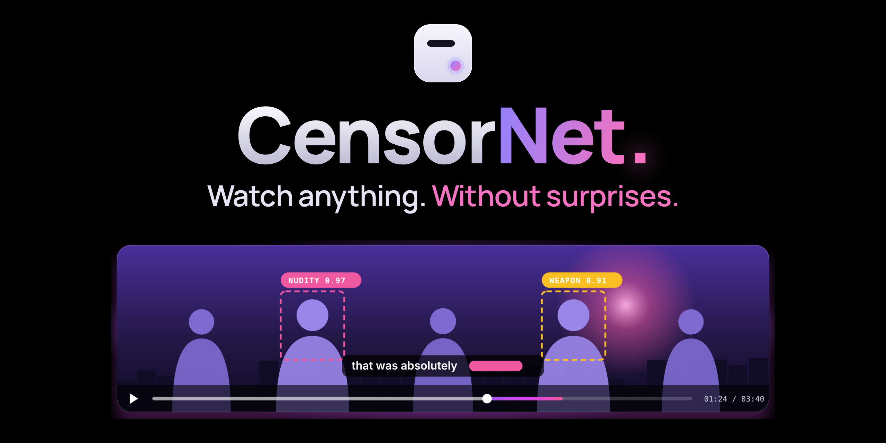
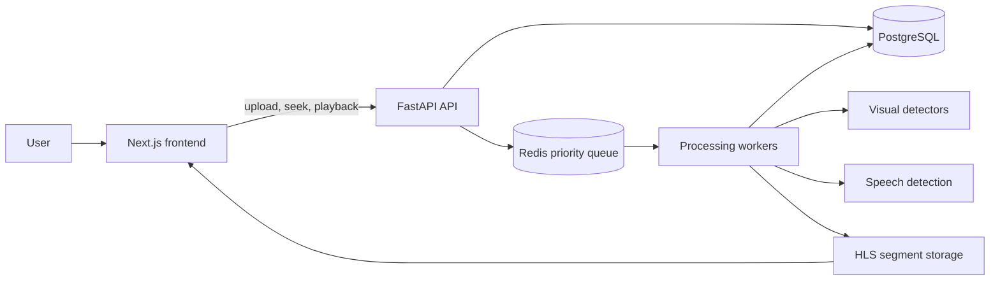
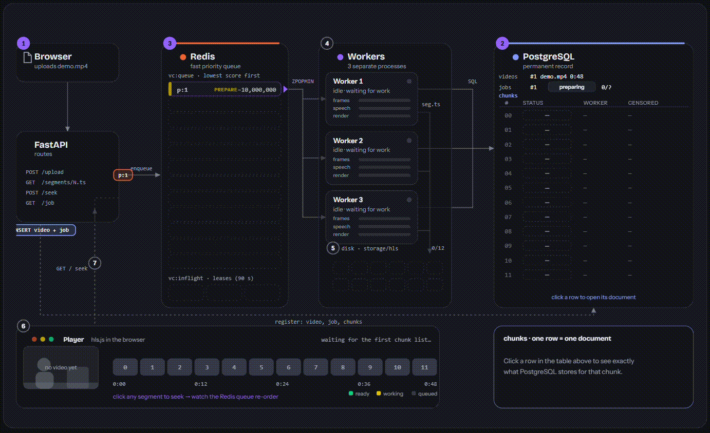

<p align="center">
  
</p>

<p align="center">
  <b>Detects sensitive visuals and language as your video plays.</b>
</p>


<p align="center">
  <a href="https://drive.google.com/drive/u/1/folders/1cizp-PJzEeS3z8CStZZUOpFcHRiYNMQR">
    
  </a>
</p>

<p align="center">
  
  
  
  
  
</p>

<p align="center">
  <a href="#-what-it-does">🎬 What it does</a> &nbsp;·&nbsp;
  <a href="#-how-it-censors">🔍 Pipeline</a> &nbsp;·&nbsp;
  <a href="#-architecture">🧩 Architecture</a> &nbsp;·&nbsp;
  <a href="#-quick-start">🚀 Quick start</a> &nbsp;·&nbsp;
  <a href="#-how-work-is-prioritised">🎯 Priorities</a> &nbsp;·&nbsp;
  <a href="#-configuration">🔧 Configuration</a>
</p>

---

CensorNet is a **real-time video censorship platform**. Upload a video or paste a YouTube URL
and CensorNet starts preparing a safer HLS stream immediately, instead of waiting for the whole
video to finish processing.

The system divides a video into short chunks, detects sensitive visual and spoken content,
applies targeted censorship, and prioritises the chunks closest to the viewer's current playback
position. You can start watching while the rest of the video is still being processed.

<table align="center">
  <tr>
    <td align="center" width="25%"><h3>🙈</h3><b>Blur</b><br /><sub>only the detected regions,<br />not the whole frame</sub></td>
    <td align="center" width="25%"><h3>🔇</h3><b>Beep</b><br /><sub>English and Hindi/Hinglish<br />profanity, word by word</sub></td>
    <td align="center" width="25%"><h3>🎯</h3><b>Follow</b><br /><sub>the queue follows the<br />playhead and every seek</sub></td>
    <td align="center" width="25%"><h3>🧾</h3><b>Audit</b><br /><sub>every detection, attempt<br />and worker is recorded</sub></td>
  </tr>
</table>

## 🎬 What it does

- 📤 Upload an **MP4** or submit a **YouTube URL**.
- ⚡ Start watching as soon as the **first processed segment** is available.
- ⏩ **Jump to any point** in the timeline and have that part prioritised.
- 📊 See the **processing status of every chunk**.
- 🔎 Review what was detected: labels, timestamps, bounding boxes and beeped words.
- 🛡 Play a stream where visual detections are **blurred** and detected profanity is replaced with a **beep**.

### 💡 Why it matters

<table>
  <tr>
    <td width="50%" valign="top">
      <h4>👀 For viewers</h4>
      Long videos do not need to be fully processed before playback begins. CensorNet follows the
      viewer: if you seek to a different scene, the processing queue gives that scene priority.
      The result is a safer viewing experience with less waiting and more control.
    </td>
    <td width="50%" valign="top">
      <h4>🏢 For product and business teams</h4>
      A practical foundation for a video-safety product:
      <ul>
        <li>⏱ <b>Lower time to first playback</b> – serve the first segments early.</li>
        <li>🎯 <b>Targeted moderation</b> – blur regions, not entire frames.</li>
        <li>📈 <b>Demand-aware compute</b> – playback position decides what runs next.</li>
        <li>🧾 <b>Auditable</b> – detections, audio events, attempts and workers are stored.</li>
        <li>💪 <b>Resilient</b> – Redis coordinates work; PostgreSQL is the permanent record.</li>
        <li>🔌 <b>Extensible</b> – detectors, thresholds, profanity lists and priorities are configurable.</li>
      </ul>
    </td>
  </tr>
</table>

## 🔍 How it censors

| Input | Detection or processing | Output |
| --- | --- | --- |
| 🖼 **Video frames** | NudeNet for nudity, YOLO for weapons, and red-region analysis gated by a violence classifier for blood | Blur only the detected visual regions |
| 🎧 **Audio** | faster-Whisper transcription with the configured English and Hindi/Hinglish profanity list | Replace matching words with a beep |
| ▶ **Playback request** | HLS playlist and segment availability check | Boost the requested chunk so it is processed next |

Chunk lifecycle:

```text
pending -> processing -> completed
                    \-> failed
```

Each chunk is decoded, analysed, rendered, encoded as an MPEG-TS HLS segment, and recorded in
PostgreSQL. **A failed chunk is never served uncensored**; after the configured retry limit it
returns an error until it is retried.

## 🧩 Architecture



| Component | Responsibility |
| --- | --- |
| 🖥 **Next.js frontend** | Upload flow, job status, HLS playback, chunk progress, interactive architecture visualisation |
| ⚙ **FastAPI backend** | Upload and YouTube ingestion, job lifecycle, HLS playlists and segments, seek handling, operational endpoints |
| 🔴 **Redis** | Disposable priority queue, worker leases and heartbeats |
| 🐘 **PostgreSQL** | Permanent records: videos, jobs, chunks, detections, audio events, attempts, processing times |
| 🧠 **Workers** | Load the detection models once and process chunks independently |
| 🎞 **FFmpeg + storage** | Extract frames/audio and write completed HLS segments atomically |

> Redis is intentionally disposable. If it is cleared, the reaper rebuilds pending work from
> PostgreSQL, which is the durable record of what happened.

### 🎞 Interactive architecture animation

[](v2/frontend/app/architecture/page.tsx)

The diagram above is also a live frontend animation. Run the frontend and open
`http://localhost:3000/architecture` for the full interactive version.

- The **homepage** shows a read-only animation that starts automatically at `1x`.
- **`/architecture`** adds play/pause, restart, speed controls, timeline seeking, PostgreSQL row
  inspection, priority information and an event log.
- Moving packets represent simulated upload, queue, worker, database and playback events, one
  moving block per packet with no ghost or trail copies.
- It pauses when off-screen, when the tab is hidden or when the user pauses it, and it respects
  `prefers-reduced-motion`.
- It is a deterministic frontend explanation of the backend design; it does not process a real video.

Code: `v2/frontend/lib/arch/engine.ts`, `v2/frontend/lib/arch/useSimulation.ts`, and the SVG diagram
and packet layer in `v2/frontend/components/architecture/`.

## 🚀 Quick start

**Requirements:** Python 3.10+ · Node.js 18+ · FFmpeg and FFprobe on `PATH` · Docker Desktop ·
enough memory for the chosen detection models and worker count.

**① 🐳 Start PostgreSQL and Redis** (from `v2/`)

```powershell
docker compose up -d
```

**② 🐍 Install and configure the backend**

```powershell
cd v2\backend
python -m venv .venv
.\.venv\Scripts\Activate.ps1
pip install -r requirements.txt
copy .env.example .env
python check_setup.py
```

The first worker start may download the configured Whisper, YOLO and violence-classifier models.
For GPU deployments, install the matching CUDA build of PyTorch and set `DEVICE=cuda` in
`backend/.env`.

**③ 🌐 Install and run the frontend** (separate terminal)

```powershell
cd v2\frontend
npm install
npm run dev
```

**④ 🏁 Run the API and workers** (terminals with the backend venv active)

```powershell
cd v2\backend
uvicorn app.main:app --port 8000
```

```powershell
cd v2\backend
python run_workers.py -n 3
```

Open **http://localhost:3000**, upload a video and open the generated video page.
API health check: `http://localhost:8000/health`.

<details>
<summary><b>📁 Repository structure</b></summary>

```text
CensorNet/
├─ v2/                         Current full-stack implementation
│  ├─ backend/
│  │  ├─ app/
│  │  │  ├─ models/            SQLAlchemy database models
│  │  │  ├─ routes/            Video, job, and chunk API routes
│  │  │  ├─ schemas/           Pydantic request/response schemas
│  │  │  ├─ services/          Queue, detection, audio, rendering, and storage logic
│  │  │  └─ workers/           Worker process entry point
│  │  ├─ tests/                Backend tests
│  │  ├─ requirements.txt      Python dependencies
│  │  └─ run_workers.py        Start workers in one terminal
│  ├─ frontend/
│  │  ├─ app/                  Next.js routes and global styles
│  │  ├─ components/
│  │  │  ├─ architecture/      Interactive architecture visualisation
│  │  │  ├─ home/              Homepage sections and animation preview
│  │  │  ├─ layout/            Navigation and footer
│  │  │  ├─ upload/            File and YouTube input components
│  │  │  └─ video/             Player, buffer, job, and chunk components
│  │  └─ lib/                  API client, status helpers, and simulation engine
│  ├─ docker-compose.yml       PostgreSQL and Redis
│  └─ README.md                Detailed v2 operational notes
└─ v1/                         Earlier frontend/backend implementation
```

</details>

## 🎯 How work is prioritised

Chunks nearer to the playhead receive higher priority:

| Tier | Purpose |
| --- | --- |
| 🚨 `STALL` | The exact segment currently blocking playback |
| 🔥 `URGENT` | The playhead chunk and the configured prefetch window |
| ⏭ `AHEAD` | Future chunks, ordered nearest first |
| ⏮ `BEHIND` | Previously watched chunks, useful when the viewer seeks back |

Workers claim chunks atomically in PostgreSQL after taking work from Redis, so two workers never
process the same chunk. Leases and heartbeats let abandoned work be requeued if a worker stops
unexpectedly.

## 🔧 Configuration

Settings live in `v2/backend/.env.example`. Common tuning points:

| Setting | Controls |
| --- | --- |
| `ANALYZER` | Enabled visual and audio analysers |
| `CHUNK_SECONDS` | Chunk duration and seek granularity |
| `ANALYSIS_FPS` | Visual sampling rate |
| detector thresholds | Sensitivity and false positives |
| `WHISPER_MODEL` | Speech-recognition model size |
| `PREFETCH_CHUNKS` | How much work is prepared ahead of the playhead |
| `WORKER_COUNT` + lease settings | Processing capacity and recovery behaviour |

## 🧪 Testing

```powershell
# backend tests
cd v2\backend
pytest -q

# frontend production build
cd v2\frontend
npm run build
```

## 🔭 Current scope

CensorNet currently processes **uploaded videos and YouTube sources**. It does not ingest a live
RTMP or camera feed; the chunk, queue and worker design can be extended to live sources later.

<p align="center">
  <br />
  <sub>🛡 Watch anything. Without surprises.</sub>
</p>